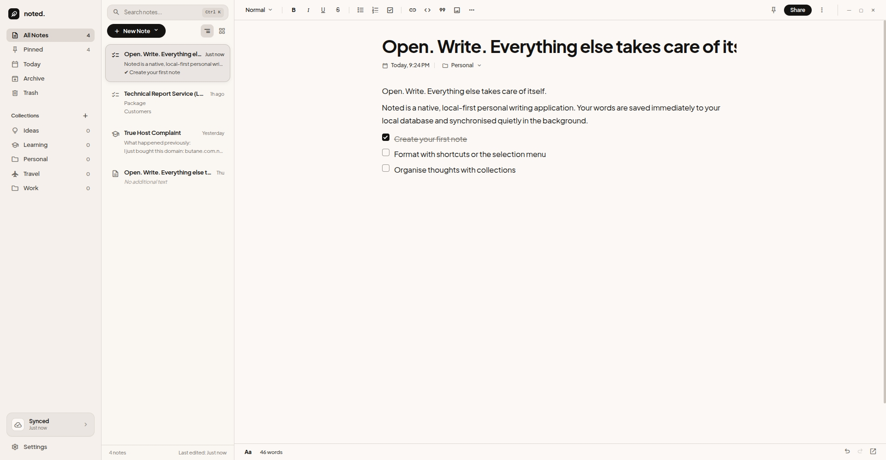

<div align="center">

# Noted

**A fast, lightweight, offline-first notes & clipboard workspace for desktop, web, and mobile.**

[](https://github.com/jayo14/noted/releases/latest)
[](https://tauri.app)
[](https://react.dev)
[](LICENSE)

[Features](#features) • [Install](#install) • [How It Works](#how-it-works) • [Clone & Run](#clone--run-locally) • [Releases](https://github.com/jayo14/noted/releases)

<br />



</div>

---

## What is Noted?

**Noted** is a distraction-free, local-first notes application built with Tauri v2, React, and SQLite. It keeps your notes fast, private, and available offline across Linux, Windows, Android, and the web—with optional Supabase sync when you want it.

## How It Works

1. **Instant Local Storage:** Every note saves immediately to **SQLite** (with FTS5 full-text search) on desktop/Android or **IndexedDB** on the web—zero loading spinners.
2. **Smart Context-Awareness:** Notes and clipboard items are automatically classified (Checklists, Code, Ideas, Recipes, Links, Colors, Images) with live task progress and matching SVG icons.
3. **Optional Cloud Sync:** Works 100% offline by default. Connect your own Supabase project in Settings to sync across devices with revision-based conflict resolution.

## Features

- **Rich Hybrid Editor:** Built on TipTap v3 with slash commands (`/`), floating formatting bubble menu, checklists, tables, code blocks, and smart Markdown paste.
- **Linux Persistent Clipboard Manager:** Captures copied text, rich HTML, shell commands, colors, and images in the background (with system tray persistence on close, `Super + V` global shortcut, 500-item unpinned retention, and instant FTS5 search).
- **Fast & Lightweight:** Tree-shaken SVG icons, code-split chunks, and native Rust/SQLite performance.
- **Desktop & Mobile Ready:** Adaptive 3-pane desktop layout (List & Grid views, Zen mode) and dedicated mobile UI.
- **Private & Portable:** Zero telemetry. Export notes anytime as Markdown, HTML, or plain text.

---

## Install

Download installers directly from the [**Latest Release**](https://github.com/jayo14/noted/releases/latest) or browse [**All Releases**](https://github.com/jayo14/noted/releases).

### Linux (Ubuntu, Zorin, Mint, Fedora, Arch, etc.)

**Recommended — One-line Bash Installer (AppImage):**
```bash
curl -fsSL https://raw.githubusercontent.com/jayo14/noted/main/install.sh | bash
```
Installs `noted` to `~/.local/bin/noted` (auto-extracting if `libfuse2` is absent) and adds an application menu entry.

Or download `.AppImage` / `.deb` manually from the [Releases page](https://github.com/jayo14/noted/releases/latest).

### Windows

Download `noted_*_x64-setup.exe` (NSIS) or `noted_*_x64_en-US.msi` from the [Releases page](https://github.com/jayo14/noted/releases/latest).

### Android

Download `app-universal-release.apk` from the [Releases page](https://github.com/jayo14/noted/releases/latest).

### Update to Latest Version

**Linux (Bash):**
```bash
pkill -x noted || true && curl -fsSL https://raw.githubusercontent.com/jayo14/noted/main/install.sh | bash
```

**Windows (PowerShell):**
```powershell
Stop-Process -Name "noted" -Force -ErrorAction SilentlyContinue; $url = (Invoke-RestMethod "https://api.github.com/repos/jayo14/noted/releases/latest").assets | Where-Object { $_.name -like "*x64-setup.exe" } | Select-Object -First 1 -ExpandProperty browser_download_url; $out = "$env:TEMP\noted-setup.exe"; Invoke-WebRequest -Uri $url -OutFile $out; Start-Process $out -Wait
```

---

## Clone & Run Locally

```bash
git clone https://github.com/jayo14/noted.git
cd noted
pnpm install

# Run as native desktop app (Tauri v2)
pnpm tauri dev

# Or run web-only dev server
pnpm dev
```

---

## Documentation

- [Architecture & Sync](docs/ARCHITECTURE.md) — Offline-first storage adapters, sync engine, and Supabase setup
- [Keyboard Shortcuts](docs/SHORTCUTS.md) — Hotkeys, slash commands, and Markdown triggers
- [Development & Testing](docs/DEVELOPMENT.md) — Prerequisites, test suites, and build scripts
- [Packaging Guide](docs/packaging.md) & [Android Packaging](docs/android-packaging.md)
